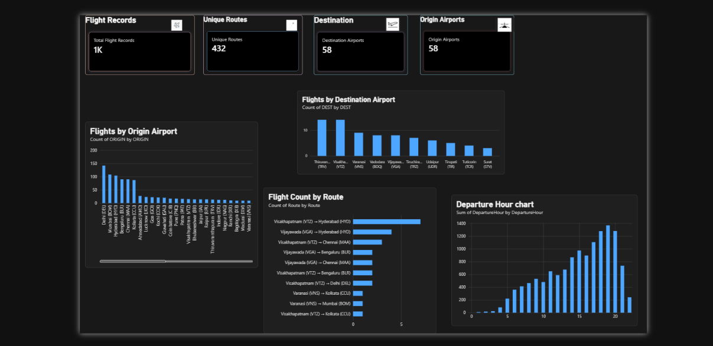
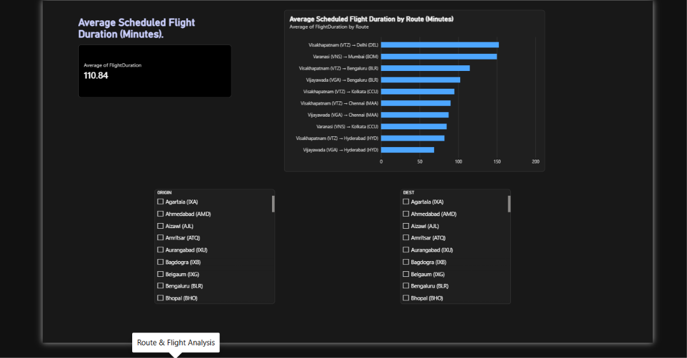
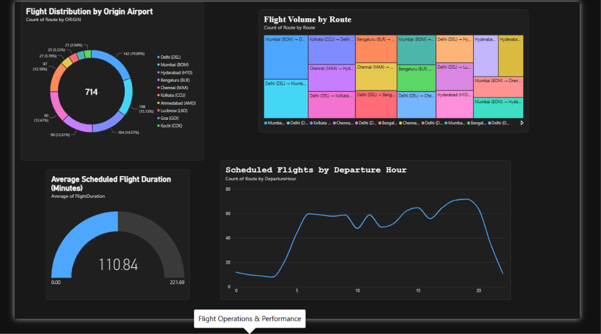

### Airline Route & Flight Operations Analytics -- IndiGo
## Project Information
- Project Title: Airline Route & Flight Operations Analytics --
  IndiGo
- Industry: Aviation / Airline Operations
- Problem Statement: Airline schedule data can be difficult to
  interpret when reviewing route coverage, airport activity, scheduled
  flight duration, and departure patterns. This project uses SQL and
  Power BI to organize and explore IndiGo flight schedule data through
  queries and interactive dashboards.
- Project Objectives:
  - Load and validate the flight schedule dataset in MySQL.
  - Analyze origin--destination routes and airport activity using
    SQL.
  - Calculate scheduled flight duration and departure hour.
  - Build Power BI dashboards for executive overview, route
    analysis, and flight operations.
- Dataset Name: IndiGo flight schedule dataset (Indigo_Fleet
  source file; working copy imported into MySQL)
- Dataset Source: Aircraft-Routing GitHub
  repository
- Database Name: indigo_database
- Table Name: flight_data
  
## Tools & Technologies
- MySQL
- SQL
- Power BI Desktop
- Power Query
- DAX
- CSV / Excel for dataset preparation

  
## Project Overview
This project explores IndiGo flight schedule data to understand route
patterns, airport activity, and scheduled flight durations. The dataset
was imported into MySQL, checked for missing values and duplicate
schedule combinations, and queried to summarize routes and airports.
Power BI was then connected to MySQL to create calculated columns,
measures, and interactive report pages.
The dashboards support exploration of the available schedule data. They
should not be interpreted as a live operational monitoring system or as
verified actual flight performance.
Dataset Information
The working dataset contains 1,049 records in the imported MySQL
table.
Important fields used in the analysis include:
- ORIGIN --- origin airport
- DEST --- destination airport
- CRS_DEP_DATETIME --- scheduled departure datetime
- CRS_ARR_DATETIME --- scheduled arrival datetime
- FlightDuration --- Power BI calculated column measuring the
  difference between scheduled departure and arrival in minutes
- Route --- Power BI calculated column combining origin and
  destination
- DepartureHour --- Power BI calculated column extracting the hour
  from scheduled departure time
Data quality checks completed
- Confirmed 1,049 records in the imported table.
- Checked missing values in ORIGIN, DEST, CRS_DEP_DATETIME, and
  CRS_ARR_DATETIME; none were found in those fields.
- Checked duplicates using origin, destination, scheduled departure,
  and scheduled arrival; 1,049 distinct combinations were found.
- Confirmed 432 distinct origin--destination route combinations.
- Found 58 distinct origin airports and 58 distinct destination
  airports.
- All 1,049 records had positive scheduled durations.
  
## Project Workflow
Industry Selection → Problem Identification → Dataset Collection →
MySQL Database Setup → Data Validation and Cleaning → SQL Analysis →
Power BI Data Modeling → Dashboard Development → Findings and
Recommendations
## SQL Analysis
SQL was used to validate the imported data and investigate route and
airport patterns. Analyses completed include:
- Record count and distinct route count.
- Distinct origin and destination airport counts.
- Missing-value checks for key schedule fields.
- Duplicate checks using origin, destination, scheduled departure, and
  scheduled arrival.
- Top routes by flight count.
- Flight counts by origin airport.
- Monthly record distribution.
- Scheduled duration calculations using scheduled departure and
  arrival timestamps.
Selected findings
- Total records: 1,049
- Distinct routes: 432
- Distinct origin airports: 58
- Distinct destination airports: 58
- The available records were observed in January.
- Delhi (DEL), Mumbai (BOM), Hyderabad (HYD), Bengaluru (BLR), and
  Chennai (MAA) were among the highest-count origin airports.
- Mumbai (BOM) → Delhi (DEL) and Delhi (DEL) → Mumbai (BOM) were among
  the highest-count routes.
These findings describe the provided dataset only and should not be
generalized to IndiGo's complete current network.
## Power BI Dashboards
The Power BI report contains three pages.
1. Executive Overview
Includes KPI cards for total flight records, unique routes, origin
airports, and destination airports, plus visuals for flights by origin
airport, flights by destination airport, flight count by route, and
departure hour.
2. Route & Flight Analysis
Includes average scheduled flight duration by route and
origin/destination airport slicers for interactive filtering.
3. Flight Operations & Performance
Includes: - Donut chart: flight distribution by origin airport. - Line
chart: scheduled flights by departure hour. - Treemap: flight volume by
route. - Gauge: average scheduled flight duration. - Route details
table.
DAX calculations
Calculated columns: - FlightDuration --- difference in minutes between
CRS_DEP_DATETIME and CRS_ARR_DATETIME. - Route --- combines
ORIGIN and DEST. - DepartureHour --- extracts the hour from
CRS_DEP_DATETIME.
Measures include total flight records, unique routes, origin airports,
and destination airports.
## Data Analysis & Visualization
- Route analysis: records for origin--destination combinations.
- Airport activity: distribution of records across origin and
  destination airports.
- Time-of-day analysis: scheduled records by departure hour.
- Scheduled duration analysis: comparisons of scheduled travel
  duration across routes.
- KPI analysis: summary counts for records, routes, and airports.
Important Data Limitation
The source research associated with this dataset describes delay values
as simulated for modeling. Therefore, delay fields should not be
presented as verified actual IndiGo delay performance. This project
focuses on scheduled routes, scheduled times, airport activity, and
calculated scheduled durations.
## Key Insights
- The working dataset contains 1,049 scheduled flight records and 432
  distinct routes.
- The data contains 58 distinct origin airports and 58 distinct
  destination airports.
- Delhi, Mumbai, Hyderabad, Bengaluru, and Chennai were among the
  highest-count origin airports in the SQL results.
- Mumbai--Delhi and Delhi--Mumbai were among the highest-count routes
  in the SQL results.
- The available records were observed in January, so the dataset does
  not support a multi-month trend analysis.
- Average scheduled flight duration can be compared across routes in
  Power BI.
## Power BI Dashboard Screenshots
Upload your actual screenshots to 06_Screenshots/ and update these
filenames if needed.
Executive Overview

Route & Flight Analysis

Flight Operations & Performance

### 📄 Project Documentation
You can view the full project documentation here: [Airline Route & Flight Operations Analytics PDF](./05_Documentation/AIRLINE-ROUTE-and-FLIGHT-OPERATIONS-ANALYTICS-INDIGO.pdf)

IndiGo_Airline_Analytics/
├── README.md
├── 01_Raw_Dataset/
├── 02_Cleaned_Dataset/
├── 03_MySQL/
├── 04_PowerBI/
├── 05_Documentation/
└── 06_Screenshots/

## Author
- Name: Swetha
- Student ID: AF05321017
- Organization: Anudip Foundation
- Course: DBA_AI
- Batch Code: ANP-D7635
